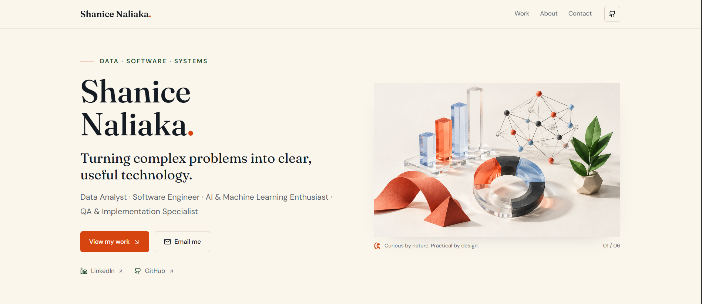
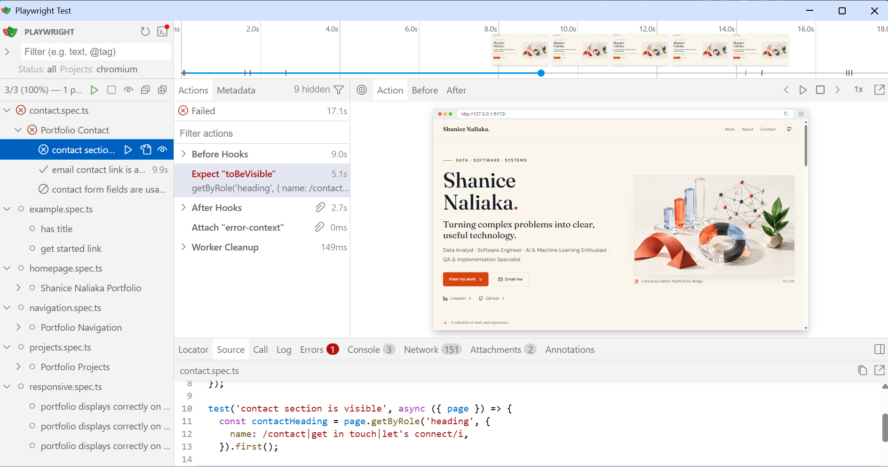
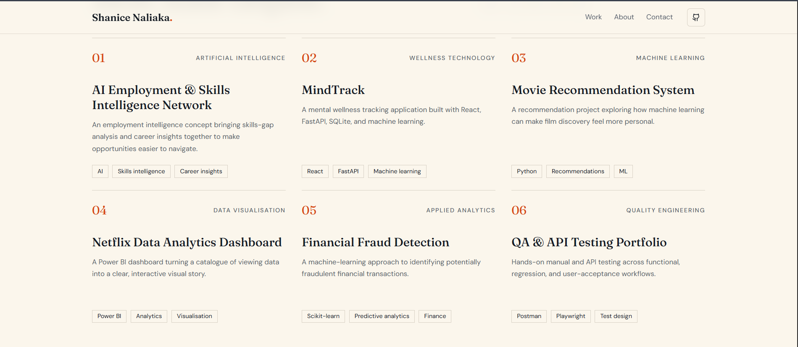
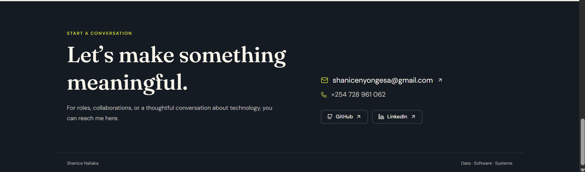

# Shanice Naliaka | Personal Portfolio

Welcome to my personal portfolio! This project showcases my technical skills, professional interests, projects, and experience across software engineering, data, AI, and digital solutions.

## About Me

I am a technology professional passionate about building practical software solutions, transforming data into insights, and exploring how AI can solve real-world problems.

My interests span software development, data analytics, artificial intelligence, quality assurance, and technology implementation.

## Technical Disciplines

- **Software Engineering:** Full-Stack Development, Frontend Development, Backend Development, API Development.
- **Data Analytics & Business Intelligence:** Data Analysis, Data Visualization, Reporting, Business Intelligence.
- **Data Engineering:** Data Processing, SQL, Database Management, Data Pipelines.
- **Artificial Intelligence & Machine Learning:** Predictive Modelling, Recommendation Systems, Machine Learning.
- **Quality Assurance:** Software Testing, Test Automation, Playwright, API Testing.
- **DevOps & Cloud:** Docker, Kubernetes, Git, GitHub, Linux, AWS.
- **Digital Solutions & Implementation:** System Integration, API Integrations, Technical Support, Requirements Analysis.

## Tech Stack

| Category | Technologies |
|---|---|
| Frontend | HTML, CSS, JavaScript, TypeScript, React |
| Backend | Node.js, Express.js, Python, FastAPI |
| Databases | MySQL, PostgreSQL, MongoDB, SQLite |
| Data & BI | Python, SQL, Power BI |
| AI & ML | Scikit-learn, Pandas, NumPy |
| Testing | Playwright, Postman |
| DevOps & Cloud | Git, GitHub, Docker, Kubernetes, Linux, AWS |
| Tools | VS Code, GitHub, Postman |

### Homepage



### About & Skills



### Featured Projects



### Contact Section




## Test Automation


This portfolio uses Playwright with TypeScript for automated browser testing.

Test coverage includes:

Homepage functionality

Navigation and links

Project sections

Contact elements

Responsive layouts

Playwright Test Results

### Playwright test screenshot


## Testing

This portfolio uses Playwright for automated browser testing.

Run tests:

```bash
npx playwright test
```

Run tests with a visible browser:

```bash
npx playwright test --headed
```

Open the interactive test runner:

```bash
npx playwright test --ui
```

## Connect With Me

- **LinkedIn:** [Shanice Naliaka](https://www.linkedin.com/in/shanice-naliaka-8a3972276/)

---

*Building, learning, testing, and creating technology that makes a difference.*
